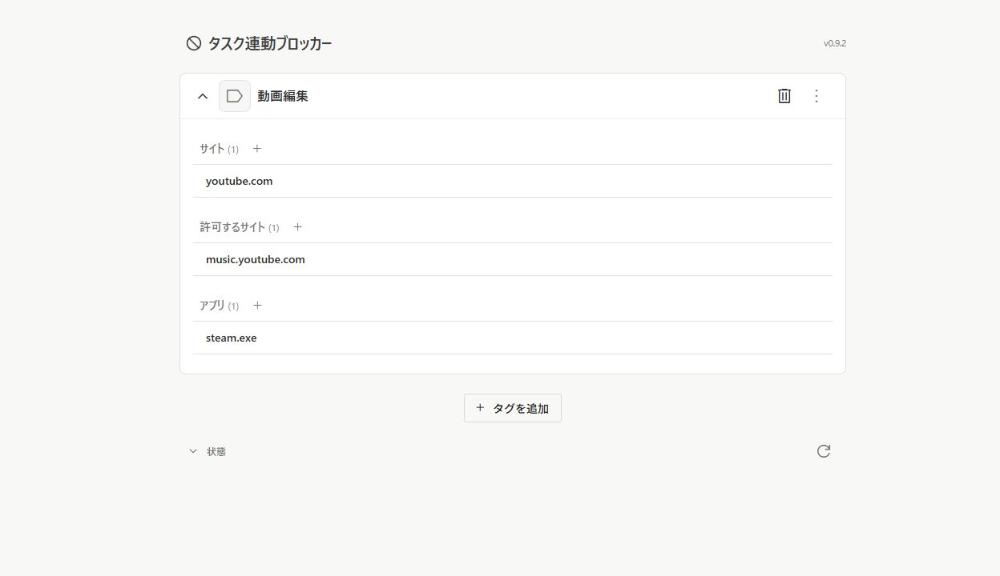

<h1 align="center">Task-linked Blocker</h1>

<strong>English</strong> · <a href="docs/README.ja.md">日本語</a> · <a href="docs/README.zh-TW.md">繁體中文</a>

<strong>Play a task. Automatically block distracting sites and apps.</strong>

A plugin for Super Productivity · Windows 11 · English / 日本語 / 繁體中文

  <a href="https://github.com/Show-Born-prog/super-productivity-task-linked-blocker/releases">Download</a> ·
  <a href="#features">Features</a> · <a href="#usage">Usage</a> · <a href="#install">Install</a> ·
  <a href="#privacy">Privacy</a> · <a href="#license">License</a>

## Features

**A focused environment for each task.** Add sites and apps to block to your existing Super Productivity tags.

- **Play to block, stop to unblock.** Rules follow task switches and Focus Mode breaks.
- **Keep using your browser.** Only registered sites are blocked, including tabs that are already open.
- **Allow part of a site.** Add subdomains as exceptions.
- **Use multiple tags.** Blocklists are combined, and allowed sites take priority.
- **Settings save automatically.** The interface follows Super Productivity's theme and language.

Super Productivity continues to handle tasks and time tracking.

## Usage

1. **Choose a tag.** Select an existing tag using **Add tag**.
2. **Add sites or apps.** Use the **＋** beside **Sites** or **Apps**.
3. **Play a task.** Rules registered to its tags activate automatically.

| What to add | Example |
| --- | --- |
| Site domain | `example.org` |
| App executable name | `sample-app.exe` |

For example, block `example.org` and allow `reference.example.org` to keep that subdomain available. Add allowed sites from **︙** beside the tag name.

Settings save automatically. 
Blocked apps are force-terminated. Unsaved work will be lost.

## Install

**Tested on Windows 11 / Super Productivity 19.2.0 / Chrome 156.**

Download the distribution ZIP from [Releases](https://github.com/Show-Born-prog/super-productivity-task-linked-blocker/releases).

1. Right-click the ZIP → **Extract All** → open the `task-linked-blocker` folder.
2. Chrome: open `chrome://extensions` → enable **Developer mode** → **Load unpacked** → select `site-blocker-extension`.
3. Super Productivity: **Settings → Plugins** → load **`task-linked-blocker-plugin.zip`**, enable it, and allow Node execution.

Node execution is used to save local settings and start the Windows app-blocking helper. Keep the extracted folder while using the plugin.

The `task-linked-blocker` folder contains `task-linked-blocker-plugin.zip`, `site-blocker-extension` and [HowToInstall.md](HowToInstall.md).

## Privacy

**Blocking and settings stay on your PC.** No account or cloud connection is required.

- Initial setup reads this extension's location from the browser's extension registration data.
- Settings are stored locally. No data is sent to the developer, and there is no analytics.
- Browser tab information is used to identify blocked sites and restore tabs after unblocking.
- Keystrokes, screenshots and clipboard contents are not collected.
- The Windows helper runs only when needed during tracking and exits when the task stops or a break begins.

## Report an issue

Include the version and steps to reproduce in [Issues](https://github.com/Show-Born-prog/super-productivity-task-linked-blocker/issues). Check settings and screenshots for personal information before posting.

## License and acknowledgements

The license for the project's original code is under review; see the [proposed MIT license](.development/LICENSE-MIT.proposed.txt).

The interface uses appearance assets from Super Productivity and Angular Material (MIT), with icons from Lucide (ISC). Sources and full license texts are listed in [THIRD_PARTY_NOTICES.md](THIRD_PARTY_NOTICES.md).

This is an independent plugin and is not affiliated with Super Productivity.
