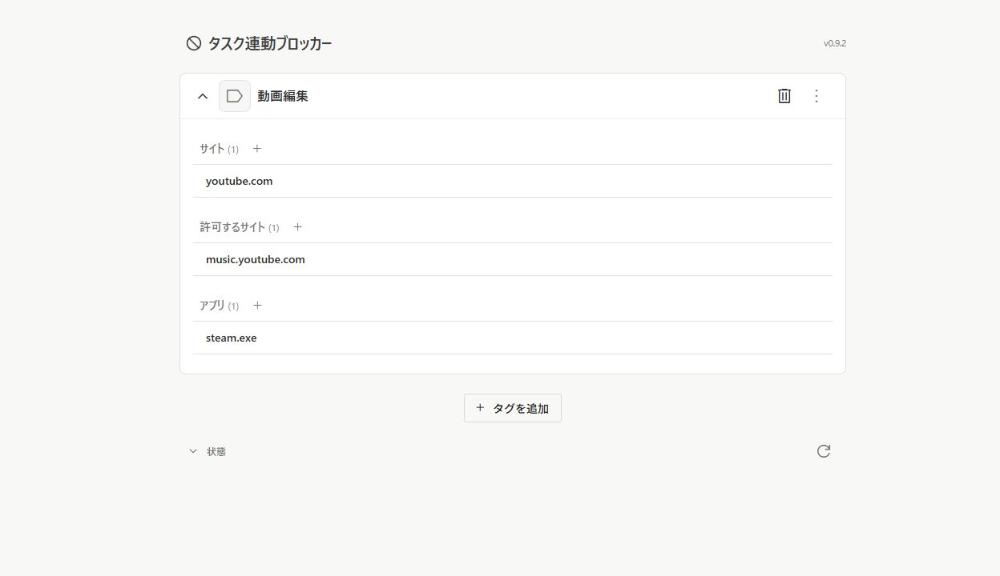

<h1 align="center">Task-linked Blocker</h1>

<a href="../README.md">English</a> · <a href="README.ja.md">日本語</a> · <strong>繁體中文</strong>

<strong>開始工作，自動封鎖讓你分心的網站與應用程式。</strong>

Super Productivity 外掛 · Windows 11 · English / 日本語 / 繁體中文

  <a href="https://github.com/Show-Born-prog/super-productivity-task-linked-blocker/releases">下載</a> ·
  <a href="#features">功能</a> · <a href="#usage">使用方式</a> · <a href="#install">安裝</a> ·
  <a href="#privacy">隱私</a> · <a href="#license">授權</a>

## 功能

**為每個工作建立專注環境。** 在 Super Productivity 現有的標籤中，加入要封鎖的網站與應用程式。

- **開始時封鎖，停止時解除。** 隨工作切換及 Focus Mode 休息自動調整。
- **瀏覽器仍可使用。** 僅封鎖已登錄的網站，也能處理已開啟的分頁。
- **允許網站的部分內容。** 可將子網域設為例外。
- **支援多個標籤。** 合併各標籤的封鎖清單，並優先套用允許網站。
- **設定自動儲存。** 介面配合 Super Productivity 的佈景主題與語言。

工作管理與時間追蹤仍由 Super Productivity 負責。

## 使用方式

1. **選擇標籤。** 透過「新增標籤」選取現有標籤。
2. **加入封鎖對象。** 使用「網站」「應用程式」旁的 **＋**。
3. **開始工作。** 自動啟用該工作標籤中登錄的規則。

| 加入的項目 | 輸入範例 |
| --- | --- |
| 網站網域 | `example.org` |
| 應用程式執行檔名稱 | `sample-app.exe` |

例如，封鎖 `example.org` 並允許 `reference.example.org`，即可繼續使用該子網域。透過標籤名稱旁的 **︙** 加入允許網站。

設定會自動儲存。 
被封鎖的應用程式會強制結束，未儲存的工作內容將會遺失。

## 安裝

**已測試環境：Windows 11 / Super Productivity 19.2.0 / Chrome 156。**

從 [Releases](https://github.com/Show-Born-prog/super-productivity-task-linked-blocker/releases) 下載發行版 ZIP。

1. 在 ZIP 上按右鍵 → **全部解壓縮** → 開啟 `task-linked-blocker` 資料夾。
2. Chrome：開啟 `chrome://extensions` → 啟用**開發人員模式** → **載入未封裝項目** → 選取 `site-blocker-extension`。
3. Super Productivity：**設定 → 外掛程式**，載入 **`task-linked-blocker-plugin.zip`**、啟用外掛，並允許執行 Node。

Node 用於儲存本機設定及啟動 Windows 應用程式封鎖輔助程式。使用期間請保留解壓縮後的資料夾。

`task-linked-blocker` 資料夾內包含 `task-linked-blocker-plugin.zip`、`site-blocker-extension` 與 [HowToInstall.md](../HowToInstall.md)。

## 隱私

**封鎖與設定儲存皆在你的電腦上完成。** 不需要帳號或雲端連線。

- 初次設定僅從瀏覽器的擴充功能登錄資訊讀取此擴充功能的位置。
- 設定儲存在本機，不會傳送給開發者，也不使用分析追蹤。
- 瀏覽器分頁資訊用於判斷封鎖網站，以及解除封鎖後還原分頁。
- 不蒐集按鍵輸入、螢幕截圖或剪貼簿內容。
- Windows 輔助程式僅在計時期間有需要時執行，停止工作或進入休息時便會結束。

## 回報問題

請在 [Issues](https://github.com/Show-Born-prog/super-productivity-task-linked-blocker/issues) 提供使用版本與重現步驟。發布前請檢查設定及螢幕截圖是否含有個人資訊。

## 授權與致謝

本專案原創程式碼的授權仍在確認中，請參閱 [MIT 授權提案](../.development/LICENSE-MIT.proposed.txt)。

介面採用 Super Productivity、Angular Material 的外觀素材（MIT），圖示來自 Lucide（ISC）。來源與完整授權條文列於 [THIRD_PARTY_NOTICES.md](../THIRD_PARTY_NOTICES.md)。

本專案為獨立外掛，與 Super Productivity 官方無隸屬關係。
